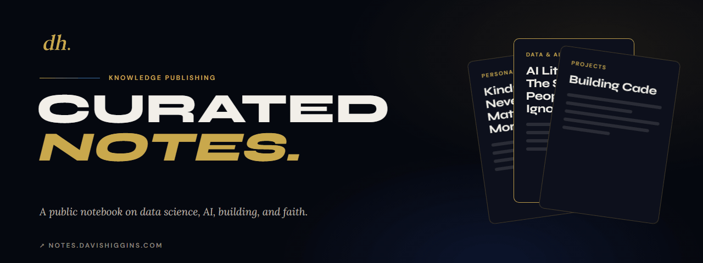
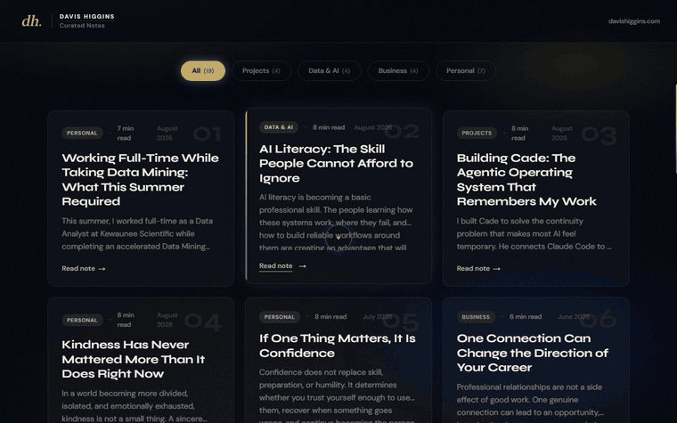
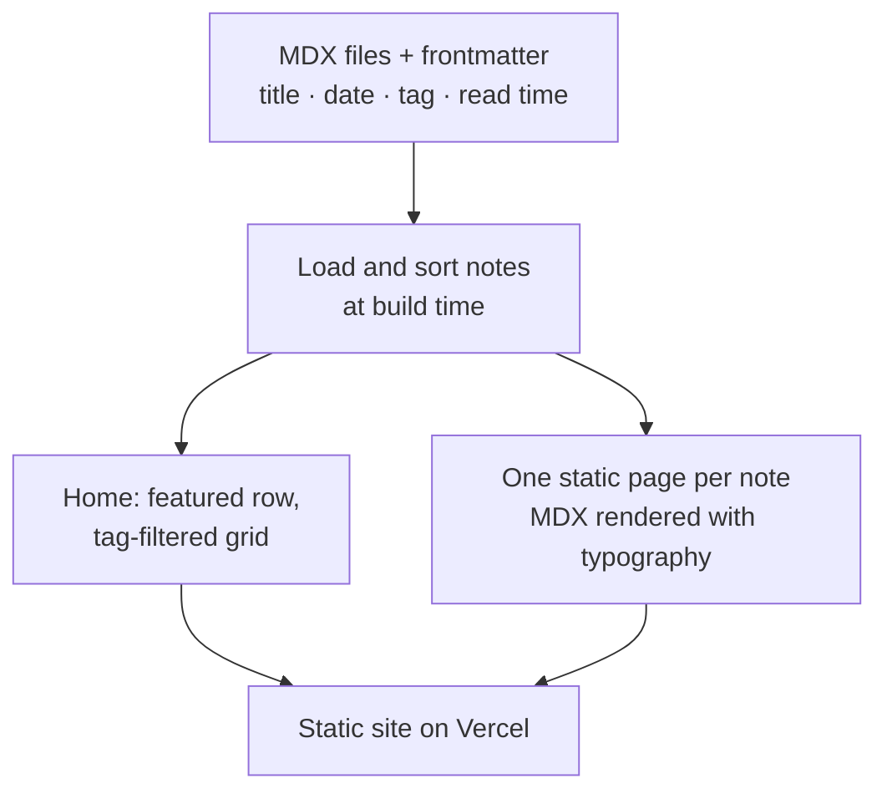
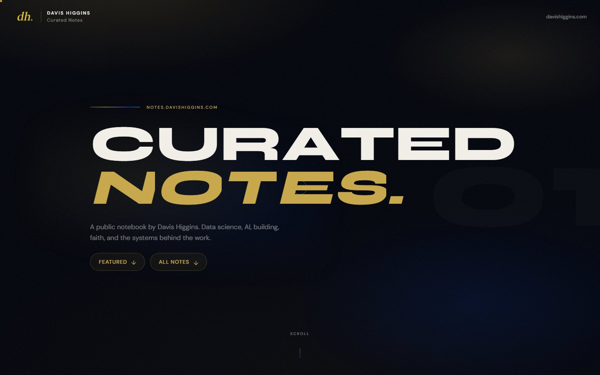
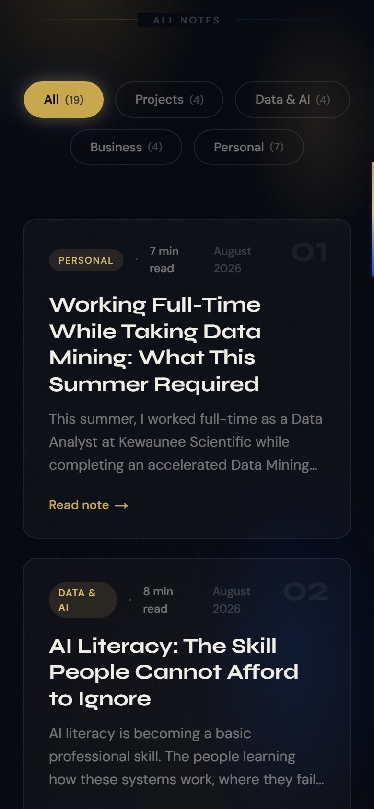
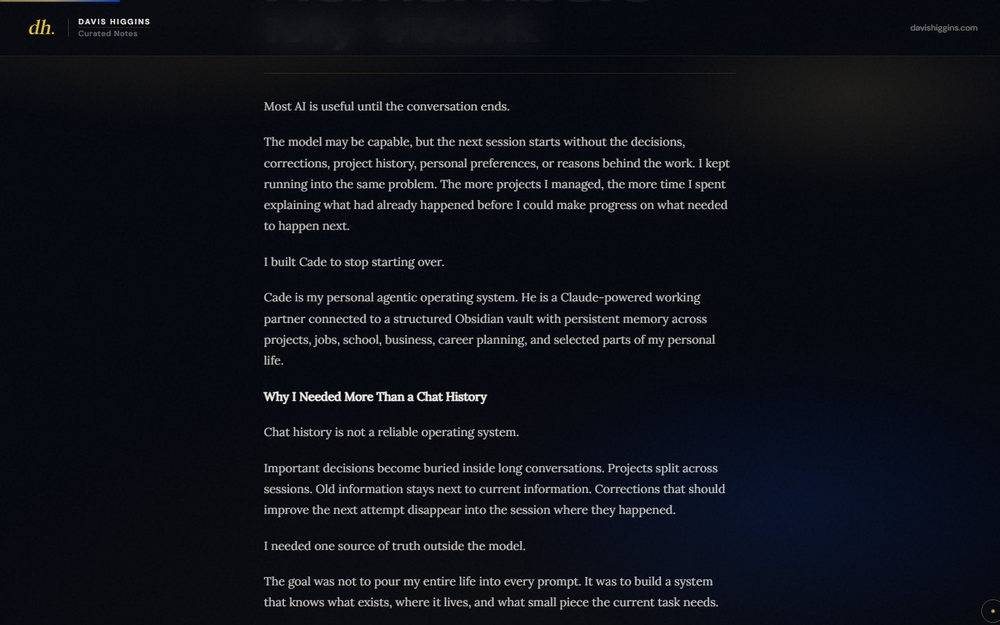

  

<h1 align="center">Curated Notes</h1>

  <strong>My public notebook: long-form notes on data science, AI, building, and faith, written in MDX and designed to be read.</strong> 
  <a href="https://notes.davishiggins.com"><strong>Read the notes ↗</strong></a> · <a href="https://davishiggins.com">Davis Higgins</a>

Live · 19 published notes · Written, designed, and built by Davis Higgins

---

## See it in motion

  

Real capture of the live site: from the note grid into a published note. <a href="assets/demo.png">Static frame</a>

## What it does

- **Notes worth finishing.** Each note is a full article with a serif reading face, a measured line length, a reading-progress bar, and links to the previous and next notes.
- **Easy to browse.** A featured row leads, then every note sits in a grid filterable by Projects, Data & AI, Business, and Personal, each card showing its date and read time.
- **Connected to the work.** Project notes link straight to the live product or case study they describe, so writing and building point at each other.

## Why I built it

I wanted somewhere to think in public that I own, rather than on a feed. The notes record how my projects were made, what I'm learning in data and AI, and what I believe, organized and readable.

## What I built

- The site's design: a dark, gold-accented editorial look with Syne for display, DM Sans for interface text, and Lora for reading
- The content pipeline: MDX files with frontmatter for title, date, tag, summary, read time, order, and an optional related-project link
- The note grid, tag filter, featured row, reading progress, note-to-note navigation, and page transitions
- All 19 published notes

## How it's put together

### Engineering decisions

| Decision | Why |
|---|---|
| **Files, not a CMS** | Notes are MDX files in the repository. Writing a note is creating a file, every edit is versioned, and there's no database or admin panel to maintain. |
| **Every note pre-rendered** | Each note gets its own static page at build time, so articles load as plain HTML and are easy for search engines to read. |
| **Typography carries the reading** | Article text uses a tuned typography system: serif body, gold links and quote rules, comfortable line length. Motion stays in the chrome and never animates paragraphs a reader is trying to read. |

Smooth scrolling uses Lenis, and decorative hero motion is skipped when `prefers-reduced-motion` is set.

## Screens

<table>
  <tr>
    <td width="62%"></td>
    <td rowspan="2" width="38%" align="center"></td>
  </tr>
  <tr>
    <td></td>
  </tr>
</table>

Homepage · A published note · Tag filters and cards on mobile

## Technology

| Layer | Technology | Responsibility |
|---|---|---|
| Framework | Next.js 15 (App Router), TypeScript | Static pages per note |
| Content | MDX (next-mdx-remote), gray-matter | Notes and frontmatter |
| Styling | Tailwind CSS with the typography plugin | Editorial layout and article type |
| Motion | GSAP, Framer Motion, Lenis | Hero, transitions, smooth scroll |
| Hosting | Vercel | Deployment |

## Scope

- **Published notes only.** Everything shown here comes from notes already public on the live site.
- **Browse, don't search.** Navigation is by tag, featured notes, and note-to-note links. There's no full-text search.

## About this repository

This is a documentation-only showcase. The site's source isn't included here.

**[Read the notes ↗](https://notes.davishiggins.com)** · Written and built by [Davis Higgins](https://davishiggins.com) · [More of my work](https://github.com/DavisHiggins)

© 2026 Davis Higgins. Text and images in this repository are shared for portfolio viewing. Note content belongs to Davis Higgins.
