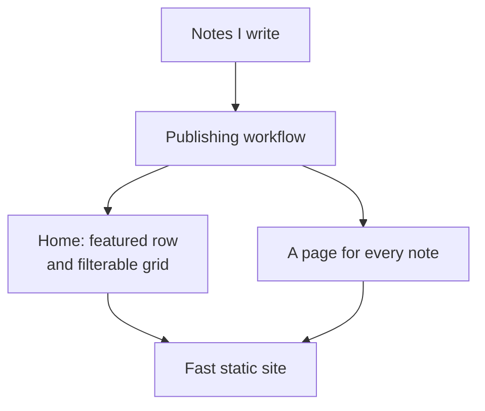

  

<h1 align="center">Curated Notes</h1>

<strong>My public notebook: long-form notes on data science, AI, building, and faith, designed to be read.</strong>

  &nbsp;
  

Live · 19 published notes · Written, designed, and built by Davis Higgins

---

## See it in motion

  

Real capture of the live site: from the note grid into a published note. <a href="assets/demo.png">Static frame</a>

## What it does

- **Notes worth finishing.** Each note is a full article with a serif reading face, a comfortable line length, a reading-progress bar, and links to the previous and next notes.
- **Easy to browse.** A featured row leads, then every note sits in a grid filterable by Projects, Data & AI, Business, and Personal, each card showing its date and read time.
- **Connected to the work.** Project notes link straight to the live product or case study they describe, so the writing and the building point at each other.

## Why I built it

I wanted a place to think in public that I own, rather than a feed. The notes record how my projects were made, what I'm learning in data and AI, and what I believe, organized and readable.

## What I built

- The site's design: a dark, gold-accented editorial look with Syne for display, DM Sans for interface text, and Lora for reading
- The publishing workflow behind every note
- The note grid, tag filter, featured row, reading progress, note-to-note navigation, and page transitions
- All 19 published notes

<strong>How it's put together</strong>

 

| Decision | Why |
|---|---|
| **Writing comes first** | Publishing a note is as simple as writing it. There's no admin panel to maintain and every edit is versioned. |
| **Every note is pre-built** | Articles load instantly and are easy for search engines to read. |
| **Typography carries the reading** | Motion stays in the frame around the article and never animates the paragraphs someone is reading. |

## Screens

<table>
  <tr>
    <td width="62%"></td>
    <td rowspan="2" width="38%" align="center"></td>
  </tr>
  <tr>
    <td></td>
  </tr>
</table>

Homepage · A published note · Tag filters and cards on mobile

## Technology

| Layer | Technology |
|---|---|
| Framework | Next.js, TypeScript |
| Content | MDX |
| Styling | Tailwind CSS |
| Motion | GSAP, Framer Motion, Lenis |
| Hosting | Vercel |

---

  &nbsp;
  

© 2026 Davis Higgins. All rights reserved. Note content belongs to Davis Higgins.

